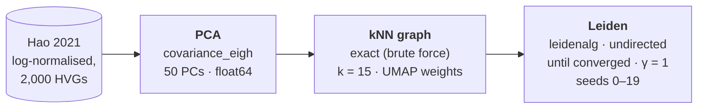

# concordance-bench

An [Omnibenchmark](https://github.com/omnibenchmark/omnibenchmark) (`ob`) benchmark
measuring concordance between single-cell pipelines (scanpy, rapids) across runs
and seeds, plus resource use (CPU, memory, GPU) per job.

## Goals

Answering the how much invisible computational choices in the PCA $\rightarrow$ kNN step (hardware, library, build, seed) and clustering change the results, how does that compare with seed noise, and does it grow with dataset size?

## Blessed baseline

## Blessed baseline

The reference every other pipeline is compared against: a CPU pipeline with every
source of randomness and approximation removed, so that repeated runs give
bitwise-identical results. Full reasoning and the defaults it overrides:
[`docs/decisions.md`](docs/decisions.md).



| Stage | Setting | Why |
|---|---|---|
| PCA | `covariance_eigh`, float64 | Direct method: no iterations, tolerance or random start, so the seed has no effect. scanpy's default (`arpack`) is iterative and seed-dependent. |
| kNN | exact search, `method="umap"` | Exact at every size; scanpy's default switches silently to approximate search above 8,192 cells. Connectivities are deterministic once the neighbours are fixed. |
| Leiden | leidenalg, `directed=False`, `n_iterations=-1`, resolution 1.0 | Reproducible per seed and runs to convergence; avoids igraph's `n_iterations=-1` bug; undirected like the GPU implementation. |
| All | single-threaded BLAS, versions pinned | Multithreaded reductions can change results in the last bits between runs. |

Leiden is a randomised heuristic: different seeds reach different, equally valid
partitions. The baseline is therefore run over 20 seeds, and the **seed-to-seed
agreement is the noise floor** against which other pipelines (scanpy defaults,
rapids-singlecell, other kNN libraries and builds) are judged.

**Status:** the PCA, kNN and Leiden options above are not yet all exposed by
`omni-scrna/scanpy` (`covariance_eigh`, exact kNN and `n_iterations` are missing);
pull requests are planned. Until then the plan runs scanpy defaults and
rapids-singlecell only.

## Setup

The environment is managed with [pixi](https://pixi.sh) and pins `ob`, denet and
the analysis stack in `pixi.lock`.

```sh
pixi install
pixi shell        # or prefix commands with `pixi run`
```

## Running

```sh
pixi run validate                                    # ob validate plan benchmark.yaml
pixi run dry                                         # ob run benchmark.yaml --dry (writes out/Snakefile only)
ob run benchmark.yaml --cores 8                      # the whole plan, locally
ob run benchmark.yaml --filter filters/smoke.yaml    # a slice of the plan (see below)
ob run benchmark.yaml --with-capability gpu          # include GPU modules
ob run benchmark.yaml -- --profile profiles/slurm    # on the lab cluster (flags after -- go to Snakemake)
ob run benchmark.yaml -m <module>                    # dev: one module's sub-graph only
```

Results land in `out/` (gitignored), nested by stage, module and parameters.

### Running part of the plan

`ob run --filter <file>` prunes the plan to the stages, modules and parameter
combinations picked in an obfilter file. The files in `filters/` are those picks:

| Filter | Runs |
|---|---|
| `smoke.yaml` | Hao 10k, 2 seeds: a quick end-to-end check |
| `cpu-only.yaml` | everything except GPU modules |
| `full.yaml` | all sizes, all seeds |

`--allow-drift` lets a filter run after the plan has changed, skipping picks that
no longer exist. If GPU modules declare `requires_capabilities: [gpu]`, they only
run when `--with-capability gpu` is passed, which may make `cpu-only.yaml`
unnecessary.

## Layout

```
concordance-bench/
├── README.md
├── CLAUDE.md                  # working rules for Claude Code sessions
├── CITATION.cff
├── LICENSE
├── pixi.toml                  # environment for running ob and for the analysis
├── pixi.lock                  # committed: pins ob, denet and analysis versions
├── .gitignore                 # out/, runs/, *.h5ad, caches
│
├── benchmark.yaml             # the ob plan: stages, modules pinned to commits, parameter sets
├── filters/                   # which parts of the plan to run (ob run --filter)
│   ├── smoke.yaml
│   ├── cpu-only.yaml
│   └── full.yaml
├── envs/                      # one conda env per software_environment in the plan
│   ├── data.yml
│   ├── scanpy.yml
│   ├── rapids.yml
│   └── analysis.yml
│
├── omnibenchmark.yaml         # entrypoints for this repo's own modules (below)
├── modules/
│   ├── hao_input.py           # Hao .h5ad -> feature-selection output format + truth labels
│   └── concordance.py         # later: pairwise metric stage (once proven in analysis/)
│
├── profiles/
│   └── slurm/config.yaml      # how Snakemake submits jobs on the lab cluster
│
├── analysis/                  # offline: reads the ob output tree, never writes into it
│   ├── load.py                #   finds runs in out/: stage, module, parameters, seed
│   ├── concordance.py         #   PCA |cos| and subspace, kNN overlap, ARI between runs and seeds
│   ├── resources.py           #   parses denet traces: CPU, memory, GPU over time per job
│   └── figures.py             #   the plotting.py panels, plus resource plots
│
├── docs/
│   ├── decisions.md           # why the blessed settings: defaults table, code findings
│   └── metrics.md             # definition of every metric, what "agreement" means
│
├── results/                   # small, committed: what goes in the thesis
│   ├── tables/                #   summary CSVs (per stage x pipeline x dataset)
│   └── figures/
│
└── out/                       # gitignored: ob writes here
```

Not all of these exist yet: `benchmark.yaml`, `omnibenchmark.yaml`, the
environment files, the filters, the modules and `LICENSE` come once the plan is
designed.

## Citation

See [`CITATION.cff`](CITATION.cff).
