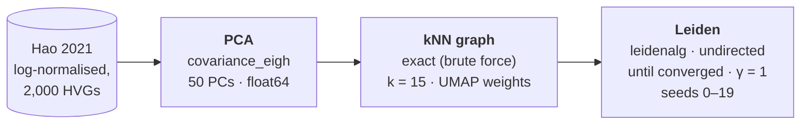

# concordance-bench

An [Omnibenchmark](https://github.com/omnibenchmark/omnibenchmark) (`ob`) benchmark
measuring concordance between single-cell pipelines (scanpy, rapids) across runs
and seeds, plus resource use (CPU, memory, GPU) per job.

## Goals

Answering how much invisible computational choices in the PCA $\rightarrow$ kNN step (hardware, library, build, seed) and clustering change the results, how does that compare with seed noise, and does it grow with dataset size?

## Blessed baseline

The reference every other pipeline is compared against: a CPU pipeline with every
source of randomness and approximation removed, so that repeated runs give
bitwise-identical results. Full reasoning and the defaults it overrides:
[`docs/decisions.md`](docs/decisions.md).



| Stage | Setting | Why |
|---|---|---|
| PCA | `covariance_eigh`, float64 | Direct method: no iterations, tolerance or random start, so the seed has no effect. scanpy's default (`arpack`) is iterative and seed-dependent. |
| kNN | exact search, `method="umap"` | Exact at every size; scanpy's default switches silently to approximate search above 8,192 cells. Connectivities are deterministic once the neighbours are fixed. |
| Leiden | leidenalg, `directed=False`, `n_iterations=-1`, resolution 1.0 | Reproducible per seed and runs to convergence; avoids igraph's `n_iterations=-1` bug; undirected like the GPU implementation. |
| All | single-threaded BLAS, versions pinned | Multithreaded reductions can change results in the last bits between runs. |

Leiden is a randomised heuristic: different seeds reach different, equally valid
partitions. The baseline is therefore run over 20 seeds, and the **seed-to-seed
agreement is the noise floor** against which other pipelines (scanpy defaults,
rapids-singlecell, other kNN libraries and builds) are judged.

**Status:** `omni-scrna/scanpy` does not yet expose `covariance_eigh`, exact kNN
or `n_iterations`. The baseline modules (`pc-baseline`, `nn-baseline`,
`cl-baseline`) therefore run the
[`Hephaestus-Hammer/scanpy`](https://github.com/Hephaestus-Hammer/scanpy/tree/baseline-options)
fork, which adds them; the plan moves back to `omni-scrna/scanpy` once they are
merged upstream. The baseline runs seed 0 only until the seed design is settled.

## Setup

The environment is managed with [pixi](https://pixi.sh) and pins `ob`, denet and
the analysis stack in `pixi.lock`.

```sh
pixi install
pixi shell        # or prefix commands with `pixi run`
```

## The plan

`benchmark.yaml` runs the Hao 2021 PBMC data at 10k, 50k and 100k cells through
separate PCA, kNN and clustering stages, each with three modules: scanpy
defaults (CPU), the blessed baseline (CPU) and rapids-singlecell (GPU):

```
data -> input (hao_input) -> pca -> knn -> cluster
```

| Stage | scanpy defaults | baseline | rapids-singlecell |
|---|---|---|---|
| `data` | the published sc-brrr input on Hugging Face, pinned to a dataset revision | | |
| `input` | `hao_input`: `.h5ad` -> omni-scrna feature-selection format + truth labels | | |
| `pca` | arpack, 50 PCs, float64 | covariance_eigh, 50 PCs, float64, 1 BLAS thread | covariance eigh, 50 PCs, float64 |
| `knn` | 15 neighbours, pynndescent (approximate above 8,192 cells) | 15 neighbours, exact (sklearn brute force) | 15 neighbours, cuVS brute force (exact) |
| `cluster` | Leiden (igraph, 2 iterations), resolution 1.0 | Leiden (leidenalg, until converged), resolution 1.0 | Leiden, resolution 1.0 |

Every module consumes every upstream output, so implementations mix (e.g. rapids
PCA -> baseline kNN -> scanpy Leiden): 27 combinations per size, 81 in all (8 per
size on a CPU host). That is what attributes disagreement to a stage. The
scanpy-defaults and rapids modules are
[omni-scrna/scanpy](https://github.com/omni-scrna/scanpy) and
[omni-scrna/rapids-singlecell](https://github.com/omni-scrna/rapids-singlecell),
run unchanged. Every seed is fixed at 0 for now.

## Running

```sh
pixi run validate                                         # ob validate plan benchmark.yaml
pixi run dry                                              # ob run benchmark.yaml --dry (writes out/Snakefile only)
ob run benchmark.yaml --cores 8                           # the whole plan; on a CPU host, rapids is skipped
ob run benchmark.yaml --cores 8 --with-capability gpu     # the whole plan, including rapids
ob run benchmark.yaml --filter filters/smoke.yaml         # a slice of the plan (see below)
ob run benchmark.yaml -- --profile profiles/slurm         # on the lab cluster (flags after -- go to Snakemake)
ob run benchmark.yaml -m <module>                         # dev: one module's sub-graph only
```

Results land in `out/` (gitignored), nested by stage, module and parameters.
The data stage downloads from Hugging Face, so the host running it needs network
access.

### Running part of the plan

`ob run --filter <file>` prunes the plan to the stages, modules and parameter
combinations picked in an obfilter file. The files in `filters/` are those picks:

| Filter | Runs | Host |
|---|---|---|
| `smoke.yaml` | 10k, CPU modules (scanpy defaults + baseline): a quick end-to-end check | any |
| `smoke-gpu.yaml` | 10k, every module: 27 combinations | GPU |
| `cpu-only.yaml` | all sizes, CPU modules (scanpy defaults + baseline) | any |

**A filter bypasses the capability gate:** every module it picks runs, even
rapids on a CPU host. That is why the CPU filters leave the rapids modules out.
`--allow-drift` lets a filter run after the plan has changed, skipping picks that
no longer exist.

## Layout

```
concordance-bench/
├── README.md
├── CLAUDE.md                  # working rules for Claude Code sessions
├── CITATION.cff
├── LICENSE
├── pixi.toml                  # environment for running ob and for the analysis
├── pixi.lock                  # committed: pins ob, denet and analysis versions
├── .gitignore                 # out/, runs/, *.h5ad, caches
│
├── benchmark.yaml             # the ob plan: stages, modules pinned to commits, parameter sets
├── filters/                   # which parts of the plan to run (ob run --filter)
│   ├── smoke.yaml
│   ├── smoke-gpu.yaml
│   └── cpu-only.yaml
├── envs/                      # one conda env per software_environment in the plan
│   ├── data.yml               #   omni-huggingface (data download)
│   ├── scanpy.yml             #   omni-scrna/scanpy; also runs hao_input
│   └── rapids.yml             #   omni-scrna/rapids-singlecell (CUDA 13)
│
├── omnibenchmark.yaml         # entrypoints for this repo's own modules (below)
├── modules/
│   ├── hao_input.py           # Hao .h5ad -> feature-selection output format + truth labels
│   └── concordance.py         # later: pairwise metric stage (once proven in analysis/)
│
├── profiles/
│   └── slurm/config.yaml      # how Snakemake submits jobs on the lab cluster
│
├── analysis/                  # offline: reads the ob output tree, never writes into it
│   ├── load.py                #   finds runs in out/: stage, module, parameters, seed
│   ├── concordance.py         #   PCA |cos| and subspace, kNN overlap, ARI between runs and seeds
│   ├── resources.py           #   parses denet traces: CPU, memory, GPU over time per job
│   └── figures.py             #   the plotting.py panels, plus resource plots
│
├── docs/
│   ├── decisions.md           # why the blessed settings: defaults table, code findings
│   └── metrics.md             # definition of every metric, what "agreement" means
│
├── results/                   # small, committed: what goes in the thesis
│   ├── tables/                #   summary CSVs (per stage x pipeline x dataset)
│   └── figures/
│
└── out/                       # gitignored: ob writes here
```

Not written yet: `modules/concordance.py`, the `analysis/` code, the docs and
`LICENSE`.

## Citation

See [`CITATION.cff`](CITATION.cff).
